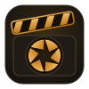

<p align="center">
  
</p>

<h1 align="center">Absolute Cinema SL</h1>
<p align="center"><b>A machinima viewer for Second Life</b></p>

<p align="center">
  <a href="LICENSE"></a>
</p>

**Absolute Cinema SL** is a [Second Life](https://secondlife.com) viewer for making films, music videos and cinematic stills in-world. It gives creators far more control over cameras, timing, staging, actors and look than a standard viewer. It is based on the [Alchemy Viewer](https://github.com/AlchemyViewer/Alchemy), with features borrowed from Firestorm and Black Dragon, all built on the official [Linden Lab viewer](https://github.com/secondlife/viewer).

Everything a shoot needs is in one place, the **Director**: camera moves, cinematic lighting, lens effects, stylised looks, weather, actors and takes. **Ghost Studio** fills your scene with clones and crowds. A built-in **ReShade bridge** gives effects such as iMMERSE RTGI and ambient occlusion the viewer's real scene data.

📖 **[Machinima Feature Guide](doc/MACHINIMA_USER_GUIDE.md)**: what every feature does and how to reach it.

> [!WARNING]
> **Independent and unaffiliated.** Absolute Cinema SL is an independent, AI "vibe-coded" project, built with heavy AI assistance. It is **not a TPV-compliant viewer**, is **not approved by Linden Lab**, and is **not affiliated with, endorsed by, or supported by** Alchemy, Firestorm, Black Dragon or Linden Lab. All product names and trademarks belong to their respective owners.
>
> **No warranty; use at your own risk.** It is provided **"as is", without warranty of any kind**. Using it may violate the Second Life Terms of Service, and any consequences, including **suspension or termination of your Second Life account**, are your sole responsibility. See the [full disclaimer](doc/MACHINIMA_USER_GUIDE.md) in the guide.

> **Everything is viewer-side.** Lights, looks, weather, camera moves, ghosts, stepped animation and the other effects are drawn by your viewer only. Other residents see the world as normal, and nothing is changed on the server. What you see is what you record.

---

## 👻 Ghost Studio: clones & crowds

Clone any avatar, yourself included, into copies you can place, pose, animate and style. Use them for doubles, background extras, crowds, mirror shots and stylised effects. The clones exist only in your viewer, so you can fill a scene without anyone else being there.

- **Two kinds of clone:**
  - **Overlay ghosts:** lightweight copies for crowds and effects.
  - **Entity clones:** full clones that take the scene's lighting like a real avatar.
- **Place them anywhere:** click the ground to place, snap to an actor or to you, drop to ground, align feet, set yaw and scale (0.05× to 150×), or drag them in-world. Copy and paste transforms between clones.
- **Pose and animate:**
  - grab a pose, or follow the source avatar live;
  - **true mirror mode** for perfectly mirrored doubles;
  - per-clone animation speed and look-at (camera, you, or a target);
  - turn-to-face;
  - an animation library;
  - **AutoAnimate** idle life, so a crowd doesn't stand frozen.
- **Crowds:** build lines, rings and formations from one source, and add per-clone variation ("chaos") so the crowd isn't identical.
- **Looks:** Ghost, Clone, Hologram, Wireframe, X-ray, Thermal, Neon Outline, Silhouette, Toon-Ink and more.
- **Fast chat commands:**
  - `/ghostdress` clones the targeted avatar;
  - `/ghostscale`, `/ghostturn`, `/ghostlook` and `/ghostanim` adjust clones;
  - `/ghostchaos` varies a crowd;
  - `/ghostclear` removes them.

Open it from the Director (Cast › Ghosts) or the Me menu. The full reference is in the [feature guide](doc/MACHINIMA_USER_GUIDE.md#7-ghost-studio-clones).

---

## 🎬 The Director

The Director is a single panel organised the way a film crew works: **Quick, Cast, Performance, Camera, Lens, Light, Look, World and Capture**. Each page groups its controls into cards with presets, a reset on every control, undo/redo, copy/paste between cards, and a search that finds any control by name, setting or synonym.

- **Quick:** your favourite controls from any page, gathered on one page.
- **Transport bar:** ACTION / CUT, take playback, timecode and recording indicator, plus scene save, load and rename. Your scene autosaves, so a crash or disconnect doesn't lose the setup.
- **Cast list:** add avatars and animated objects as actors, assign subjects A–D, and target any page's effect at "You", a subject, or the whole cast.

### 🎥 Camera
- **Cinematic camera** with over 50 camera moves: dolly zoom, hero arc, crane, orbit, whip pan, overhead, skimmer, barrel roll, cable cam, Pedro cam and more. Every move has its own timing and framing controls.
- **Camera switcher:** 12 shot slots (wide, medium, close-up, OTS, profile and more) with an auto-director that cuts on a timer, eased cuts, and optional slow-motion or freeze-frame on the cut.
- **Handheld operator:** realistic camera shake and drift with presets such as Locked-off, Documentary, Run-and-gun and Heartbeat. It reacts to how fast the camera is moving.
- **Frame & Orbit:** target delivery formats (Scope 2.39:1, 16:9, 4:3, vertical and more) with framing guides, skeleton auto-reframe, and an orbit camera anchored to any avatar joint.
- **Shot builders:** one-button over-the-shoulder pairs, dolly zooms and hero arcs from your cast.
- **Takes:** record a camera move and play it back.

### 🕹️ Flycam & gamepad
- **Three flight models:** Classic (the standard flycam), **Weighted Classic**, which adds mass and momentum so the camera coasts and settles like a real rig, and **Drone**, with full drone-style flight physics.
- **Xbox controller support** (XInput): D-pad actions, and triggers that roll the camera or act as **gas and brake**. The gas builds momentum faster, the brake stops a coasting camera in about a second, and an impact slider sets how strong both are. Rumble feedback is optional.

### 📺 VCam: virtual cameras
- Place **virtual cameras** in the scene and show their live picture on any surface, such as TVs, monitors or screens, or use them as a **projector** light.
- A monitor strip previews every camera, and each camera can follow an avatar's bone for a POV shot.
- Projector looks: film grain, gate weave, flicker, keystone, gels, gobos and TV scanlines.

### 💡 Light
- **Cine Light Rig:** a full Key / Fill / Back / Background lighting setup around your subject, with easy lighting looks, colour temperature, gels, gobos, flicker, light shafts and per-light aim.
- **Actor-only lights:** light only your actors, not the set.
- **Rig Rim:** a per-pixel rim light with quality controls and presets.
- **Exposure, practical lights, avatar light response, and light cues** you can save and fire during a take.

### 🎨 Look
- **Image:** tonemapping, colour grading (lift, gamma, gain and tone curves), colour LUTs, chromatic aberration and vignette.
- **Bloom & Glow.**
- **Roto Ink:** dozens of stylised outline and ink styles, from comic to sketch to toon, with animated patterns.
- **Tron:** glowing edge-light and trail effects.
- **Actor FX:** per-actor stylised looks.
- **Stepped animation:** the hand-drawn "on twos" look of animated films. Characters move on a stepped 12 or 8 fps clock while the camera stays smooth. It has 14 presets, including Anime on twos, Spider-Verse mixed, Stop-motion and Claymation boil, plus smear frames, hit-stop and pose boil.

### 🔍 Lens
- **Focus:** depth of field with focus pulls and follow-focus.
- **Lens filters:** graduated ND, polariser, infrared / Aerochrome and soft-edge.
- **Split diopter:** two planes in focus at once.

### 🌦️ World
- **Weather:** rain and lightning.
- **Atmosphere:** height haze, local fog volumes, and projector light shafts.
- **Shadows & reflection probes:** shadow distance and quality, and live probe refresh modes for moving lights.

### 🎭 Performance
- **Gaze:** natural eye and head life for actors, with look-at targets and gaze cues.
- **Animation switchboard:** trigger animations on cue, with hotkeys.
- **Pose polish and movement styles:** refine poses and walks.
- **Animate:** automatic idle animation for actors and ghosts.

### 👥 Cast
- **Actor Mover:** walk actors along paths and in groups, with marks to reset to between takes.
- **Path editor:** draw and edit movement paths.
- **Prop mover:** move, spin, orbit and shuttle props, including seated avatars.
- **Ghost Studio:** clones and crowds; see [Ghost Studio](#-ghost-studio-clones--crowds) above.
- **Dance Ball:** a client-side dance controller for your actors.

### ⏱️ Capture
- **Temporal capture:** world time scale for slow-motion and time-lapse, with presets.
- **Scene options and Director hotkeys.**

---

## ✨ ReShade & iMMERSE integration

Absolute Cinema SL gives [ReShade](https://reshade.me) effects what they normally have to guess: the viewer's own **render data**, every frame.

- **The bridge add-on** (`sl_reshade_bridge.addon`, source in [`reshade-addon/`](reshade-addon/README.md)) reads the viewer's G-buffer and camera state each frame: surface normals, motion vectors, albedo, material (ORM), HDR colour, surface coverage and visible diffuse lighting. It hands them to ReShade shaders as ordinary textures and uniforms.
- **iMMERSE integration:** the included **SL G-Buffer Provider** shader feeds those real normals and motion vectors to Marty McFly's [iMMERSE](https://github.com/martymcmodding/iMMERSE) effects. **RTGI** (ray-traced global illumination) and **MXAO / RCAO** (ambient occlusion) then work from Second Life's actual geometry instead of normals reconstructed from depth. You get cleaner contact shadows, stable bounce light, and less smearing on moving avatars.
- **For shader authors:** include `SL_Bridge.fxh` to get the SL textures with the correct orientation and normal decoding, plus the camera uniforms, and use them in your own ReShade effects.

ReShade and iMMERSE are separate third-party projects; install them yourself. Setup steps and the recommended effect order are in [**reshade-addon/README.md**](reshade-addon/README.md). For depth, use ReShade's built-in `generic_depth` add-on, which the bridge is designed to work alongside.

---

## 📥 Download

There are no pre-built releases yet. Build from source as described below.

## 🔨 Building from source

Absolute Cinema SL builds the same way as Alchemy: CMake with vcpkg. Platform setup, presets, build options, tests and packaging are documented in [**doc/BUILD.md**](doc/BUILD.md).

```
git clone --recurse-submodules https://github.com/bwlupus-ctrl/Alchemy-Machinima.git alchemy-machinima
cd alchemy-machinima
python3 -m venv .venv && source .venv/bin/activate   # Windows: .\.venv\Scripts\Activate.ps1
pip install -r requirements.txt
dotnet tool restore                                  # packaging only
cmake -S indra --preset <preset>                     # see BUILD.md for presets
cmake --build build-<OS>-<preset> --config Release
```

## 🤝 Contribute

Bug reports and suggestions are welcome as [issues](https://github.com/bwlupus-ctrl/Alchemy-Machinima/issues). For pull requests, see [CONTRIBUTING](CONTRIBUTING.md).

## 🙏 Acknowledgements

Absolute Cinema SL stands on the work of:

- The [Alchemy Viewer](https://github.com/AlchemyViewer/Alchemy) team
- The Firestorm and Black Dragon viewer projects, whose features some of this work borrows from
- [ReShade](https://reshade.me) and Marty McFly's [iMMERSE](https://github.com/martymcmodding/iMMERSE) (separate third-party projects)
- [Linden Lab](https://www.lindenlab.com/) and the [Second Life Viewer](https://github.com/secondlife/viewer) contributors
- The open-source libraries the viewer uses (see [`indra/vcpkg.json`](indra/vcpkg.json))

## 📜 License

Absolute Cinema SL is licensed under the [GNU Lesser General Public License v2.1](LICENSE), inherited from the Alchemy and Linden Lab viewers.
